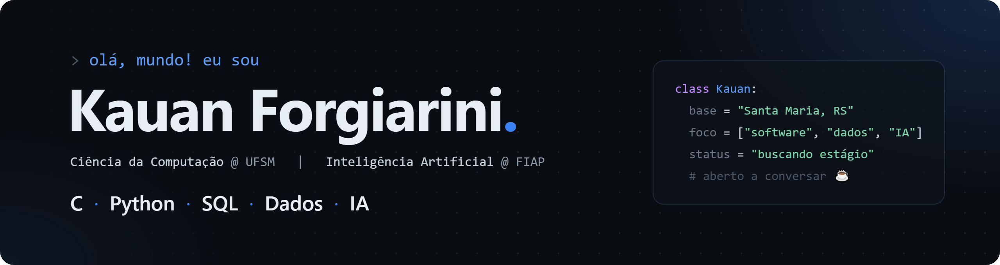

<p align="center">
  
</p>

<p align="center">
  <a href="https://github.com/KauanForgiarini">
    
  </a>
</p>

<p align="center">
  <a href="https://www.linkedin.com/in/kauanforgiarini"></a>
  <a href="mailto:kauan.mforgiarini@gmail.com"></a>
  
</p>

<br>

## 👋 Sobre mim

Sou estudante de **Ciência da Computação na UFSM** e de **Inteligência Artificial na FIAP**. Construo **agentes de IA** e **sistemas de machine learning de ponta a ponta**, do dado e do modelo até a API, o banco e o dashboard, com atenção a governança e segurança. Meus projetos vão de um agente autônomo de atendimento a modelos de ML para o agro e para a segurança de satélites.

```python
kauan = {
    "agora":        "construindo agentes de IA com guardrails e aprofundando ML",
    "na_prática":   ["Agentforce", "Python", "scikit-learn", "FastAPI", "ESP32"],
    "experiência":  "desenvolvimento web e comercial na CompactJr (empresa júnior)",
    "procurando":   "estágio em IA / AI Engineering (remoto)",
}
```

<br>

## ⭐ Projeto em destaque

<table>
  <tr>
    <td>
      <h3>🤖 <a href="https://github.com/KauanForgiarini/concierge-lumina">Concierge Lumina</a></h3>
      <p><b>Agente de IA multiagente</b> no Salesforce Agentforce que resolve por chat problemas de hóspedes de hotel: identifica o hóspede, avalia a recuperação permitida pela política, troca o quarto com confirmação, abre manutenção e fecha o caso.<br>
      Roteador e 3 subagentes, 10 actions, <b>guardrails contra alucinação</b> e <b>escalonamento para humano</b>.</p>
      <p>
        
        
        
        
      </p>
    </td>
  </tr>
</table>

## 🚀 Outros projetos

<table>
  <tr>
    <td width="50%" valign="top">
      <h4>🛰️ <a href="https://github.com/KauanForgiarini/orbit-shield">Orbit Shield</a></h4>
      Detecção de intrusão em estações terrestres de satélite, do ESP32 ao dashboard. Random Forest com F1 de 98,3%.<br>
      <sub><code>Isolation Forest</code> <code>Random Forest</code> <code>FastAPI</code> <code>ESP32</code></sub>
    </td>
    <td width="50%" valign="top">
      <h4>🛡️ <a href="https://github.com/KauanForgiarini/agrorisk-intelligence">AgroRisk Intelligence</a></h4>
      Análise preventiva de risco para equipamentos agrícolas (desafio <b>FIAP × Sompo Seguros</b>). F1 macro de 0,91.<br>
      <sub><code>FastAPI</code> <code>scikit-learn</code> <code>Streamlit</code> <code>pytest</code></sub>
    </td>
  </tr>
  <tr>
    <td width="50%" valign="top">
      <h4>👁️ <a href="https://github.com/KauanForgiarini/farmtech-fase6">FarmTech Visão Computacional</a></h4>
      Detecção de pessoas e veículos com YOLOv8, comparada a uma CNN treinada do zero.<br>
      <sub><code>YOLOv8</code> <code>Deep Learning</code> <code>Colab</code></sub>
    </td>
    <td width="50%" valign="top">
      <h4>📈 <a href="https://github.com/KauanForgiarini/farmtech-data-pipeline">FarmTech Data Pipeline</a></h4>
      Comparação de quatro modelos de regressão para irrigação, adubação e produtividade. R² de 0,81.<br>
      <sub><code>Python</code> <code>Regressão</code> <code>Streamlit</code> <code>C++</code></sub>
    </td>
  </tr>
  <tr>
    <td width="50%" valign="top">
      <h4>🌾 <a href="https://github.com/KauanForgiarini/AgroSafe">AgroSafe</a></h4>
      Registro e classificação de perdas na colheita de soja com parâmetros da Embrapa.<br>
      <sub><code>Python</code> <code>Oracle</code> <code>Classificação</code></sub>
    </td>
    <td width="50%" valign="top">
      <h4>📂 <a href="https://github.com/KauanForgiarini?tab=repositories">Ver todos os repositórios →</a></h4>
      FarmTech (irrigação com ESP32), Crop Monitor, notebooks de ML e outros projetos da FIAP.
    </td>
  </tr>
</table>

<br>

## 🧰 Tecnologias que já usei em projetos

<p align="center">
  
</p>

<p align="center">
  <sub>Também: <b>Salesforce Agentforce</b> · <b>pandas</b> · <b>YOLOv8</b> · <b>Streamlit</b> · <b>Oracle</b> · <b>ESP32</b> · <b>Jupyter</b></sub>
</p>

<br>

## 🤝 Vamos conversar?

Busco um **estágio em IA** para construir agentes e modelos que resolvam problemas de verdade, aprendendo junto com o time.
Se quiser falar sobre uma oportunidade ou sobre algum dos projetos, me chama no [LinkedIn](https://www.linkedin.com/in/kauanforgiarini) ou por [e-mail](mailto:kauan.mforgiarini@gmail.com).

<p align="center">
  
</p>
